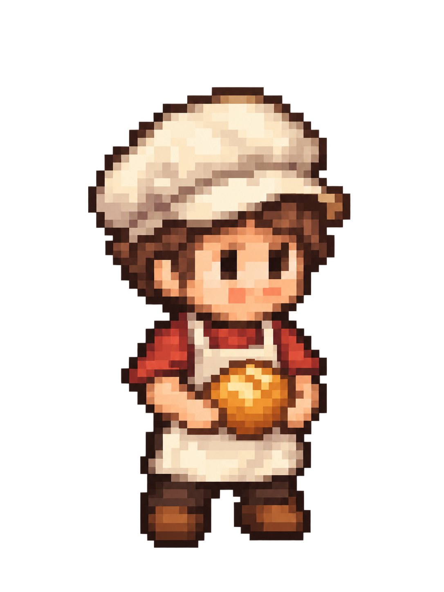
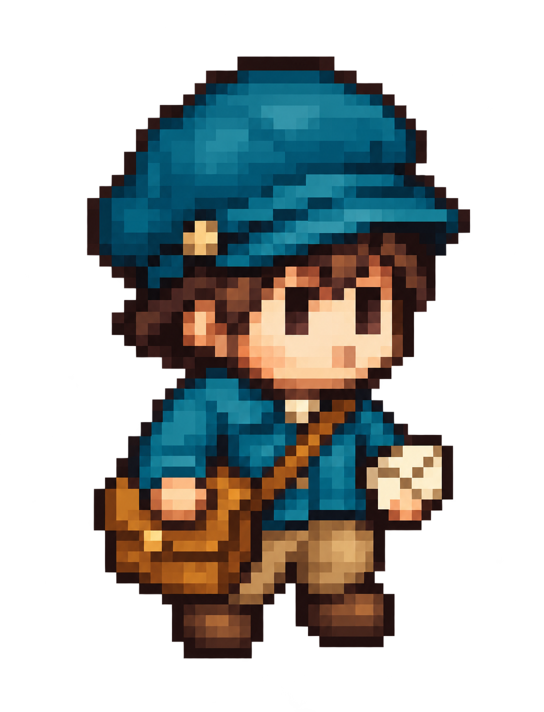
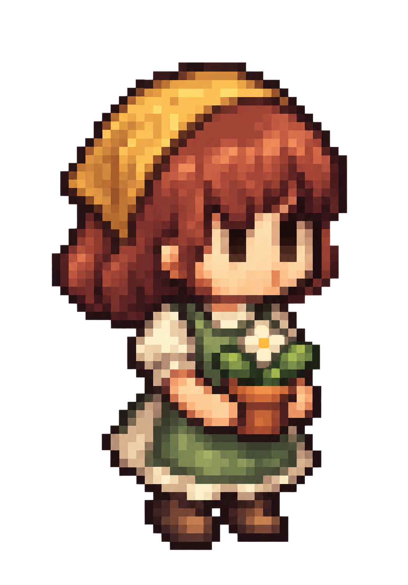

# Pixel Dev Tools

为像素游戏开发整理可复用的 **Skills、美术规范与工具**。从角色生成开始，逐步加入精灵导出、动画校验和 MCP 集成。

当前版本包含一个可单独安装的 Skill：**[cozy-pixel-characters](skills/cozy-pixel-characters/SKILL.md)**。

## Cozy Pixel Characters

用一句角色描述，生成柔和圆润的日式小镇 RPG 像素风人物。

```text
使用 $cozy-pixel-characters，生成一位拿着药瓶的炼金术士，紫色衣服，透明背景。
```

用户不需要准备参考图。Skill 默认选取随包附带的一张原创角色作为风格样板，把职业、服装、配色和道具补入统一的美术规范，再调用宿主的图像生成工具。可以明确要求“完全不使用图片参考”切换到纯文字模式。

**只输入文字**指用户的使用方式；默认生成流程仍会使用内置图片。首次独立试生成出现了细节过密、插画化和透明边缘残留，因此没有把纯文字结果宣传成稳定复现。内置参考模式也仍有眼睛偏大、装饰偏多的已知限制。

内置风格样板（默认会择一用于生成）：

<p>
  
  
  
</p>

- 约两头身、小脸、短手短腿、饱满轮廓、轻微俯视。
- 深褐描边、暖色中间调、细腻且连贯的像素色块。
- 按角色年龄设计眼睑、眉毛和少量纹路；鼻嘴与腮红位置分明，不照搬样板的面部色点。
- 避免大眼动漫立绘、复杂衣褶、粗糙马赛克、模糊边缘和塑料高光。
- 默认单人全身、透明 PNG；保存原始母版和实际生成提示词。

这是提示词和工作流的封装。结果取决于宿主的生成工具；它不会训练或安装一个专用图像模型。高分辨率的像素风母版也不等于已经逐像素整理好的原生 48×48 游戏精灵。

## 安装与使用

需要支持 `SKILL.md` 的 AI 助手，以及可用的图像生成工具。当前执行流程面向带有内置图像生成工具的 Codex；Skill 自身不包含生成服务或 API Key。

在 Codex 中可输入：

```text
使用 $skill-installer 安装 https://github.com/bpgigi/pixel-dev-tools/tree/main/skills/cozy-pixel-characters
```

也可以克隆本仓库，把 `skills/cozy-pixel-characters` 整个文件夹复制到目标游戏项目的 `.agents/skills/` 下：

```text
your-game/
└── .agents/skills/cozy-pixel-characters/
    ├── SKILL.md
    ├── agents/openai.yaml
    ├── references/
    └── assets/style-anchors/
```

需要跨项目使用时，可放在 `~/.agents/skills/`。检测不到新 Skill 时重启 Codex。安装位置与调用方式见 [OpenAI 的 Skill 文档](https://learn.chatgpt.com/docs/build-skills)。

安装后描述角色即可，也可以指定保存目录：

```text
用 $cozy-pixel-characters 画一位戴棕色软帽的小镇铁匠，
蓝灰色衣服、皮围裙，拿一把小锤子。透明背景，保存到 art/npcs/。
```

不具备图像工具的环境只能用它整理提示词，不能直接生成 PNG。若想在其他图像工具中手动使用，可复制 [提示词模板](skills/cozy-pixel-characters/references/prompt-template.md)。

## 示例与验证

实际输入、生成图片和条件记录放在 [examples/cozy-pixel-characters](examples/cozy-pixel-characters/README.md)。已完成 **3 次独立纯文字首轮生成 + 1 次内置参考图首轮生成**，均保留原始结果与不足。纯文字测试与内置参考图测试分开记录。`examples/` 不参与自动生成；默认使用的三张样板位于 Skill 自带的 `assets/style-anchors/`，用途和来源单独记录。

[evals/prompts.json](evals/prompts.json) 保留后续回归测试输入，包含白发老奶奶与紫帽魔法师的内置参考图案例。验证关注职业和年龄是否可辨、鼻嘴与腮红是否分离、比例、轮廓、眼睛、像素色块和真实透明通道；不是只检查文件能否打开。新增输入不代表已经完成测试，历史示例保留当时的提示词与结果。少量样例不能证明所有职业或生成器都能稳定复现相同画风。

## 仓库布局

```text
pixel-dev-tools/
├── skills/
│   └── cozy-pixel-characters/  # 可独立复制安装
├── examples/
│   └── cozy-pixel-characters/ # 图片、实际输入和提示词
└── evals/                     # 测试输入、评分规则与结果
```

新增 Skill 放入 `skills/<name>/`，保持单个目录可独立使用。以后真正实现 MCP 服务时，再加入 `mcp/<name>/` 及其运行说明；当前没有 MCP 服务。原生精灵网格整理、动画生成和引擎导入属于后续开发方向，当前版本只提供静态角色生成流程及保持像素感的注意事项。

## 许可证

代码、文档和随附 AI 生成图片（含内置风格样板及测试示例）均按 [MIT License](LICENSE) 分发，允许按该许可复用、修改和再分发，也可将内置样板作为生成参考。使用图像生成服务时仍需遵守该服务的条款。本仓库不包含最初用于讨论画风的第三方游戏截图或其裁切素材。
