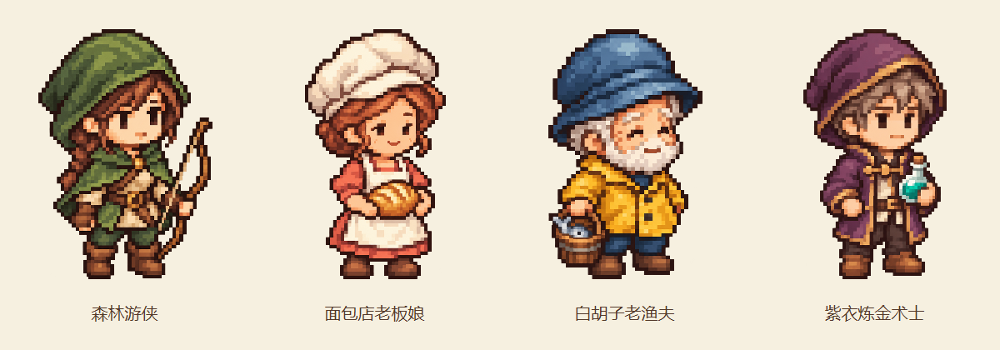
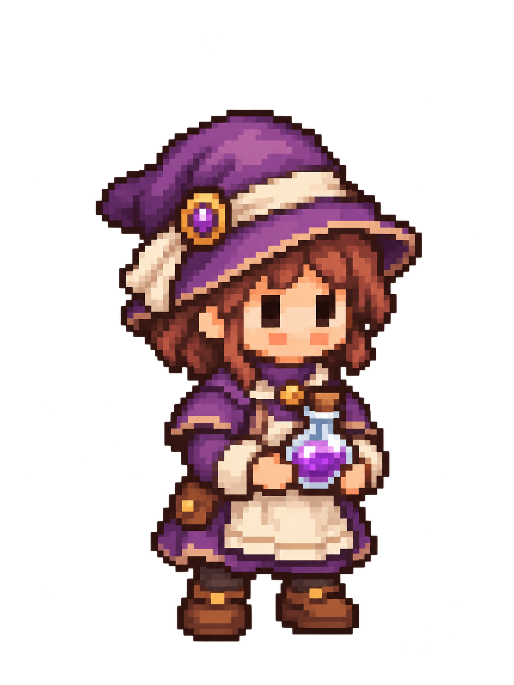
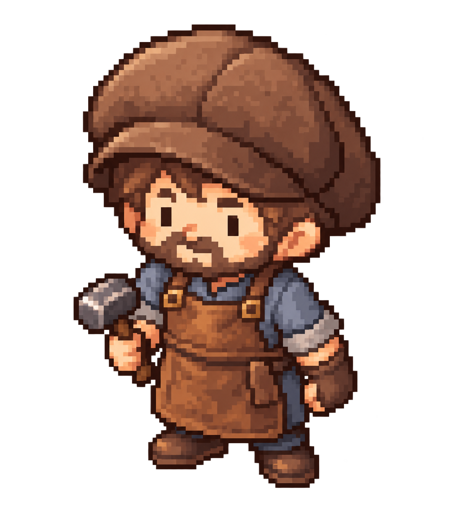

# 真实生成样例

这页展示近期角色，并保留历史首次输出和发现的问题。图片均使用内置 `image_gen` 生成，无 API 回退；生成器没有返回模型名称或种子。各角色 PNG 保留对应生成结果的原始像素与透明通道。

## 近期角色展示（2026-10-27）

这组使用修改后的年龄与五官规则，并按角色选择一张内置样板。展示图是浅色底的最近邻缩放预览；下表链接为独立透明 PNG 母版。

| 角色 | 透明原图 | 提示词与记录 | 生成情况 |
| --- | --- | --- | --- |
| 森林游侠 | [PNG](gallery-2026-10-27/forest-ranger.png) | [提示词](gallery-2026-10-27/forest-ranger-prompt.txt) · [记录](gallery-2026-10-27/forest-ranger-record.json) | postman 样板，生成 1 次 |
| 面包店老板娘 | [PNG](gallery-2026-10-27/bakery-owner.png) | [提示词](gallery-2026-10-27/bakery-owner-prompt.txt) · [修正提示词](gallery-2026-10-27/bakery-owner-correction-prompt.txt) · [记录](gallery-2026-10-27/bakery-owner-record.json) | baker 样板，初次生成后做 1 次年龄感修正 |
| 白胡子老渔夫 | [PNG](gallery-2026-10-27/old-fisherman.png) | [提示词](gallery-2026-10-27/old-fisherman-prompt.txt) · [记录](gallery-2026-10-27/old-fisherman-record.json) | postman 样板，生成 1 次 |
| 紫衣炼金术士 | [PNG](gallery-2026-10-27/alchemist.png) | [提示词](gallery-2026-10-27/alchemist-prompt.txt) · [记录](gallery-2026-10-27/alchemist-record.json) | baker 样板，生成 1 次 |

四位角色的嘴形均可辨，没有出现鼻嘴中央的分离双红点。老渔夫通过白眉、下垂笑眼与少量纹路表达年龄；精确年龄仍不能从小尺寸 Q 版角色推断。这些是静态像素风母版，尚未验证原生精灵网格或制作动画。

以下历史测试完成于 2026-10-25，每个案例只成功调用一次，原始 `character.png` 与生成输出逐字节一致。

## 默认模式：用户文字 + 内置风格样板

输入：

> 生成一位拿着药瓶的炼金术士，紫色衣服，透明背景。

Skill 自动使用随包附带的 `baker.png` 作为比例与色块参考。用户未上传图，但**生成过程有图片输入**。

[原始 PNG](bundled-reference/alchemist/character.png) · [完整提示词](bundled-reference/alchemist/prompt.txt) · [生成参数与检查](bundled-reference/alchemist/generation.json)

药瓶、紫衣和圆润的阶梯轮廓可辨认；眼睛与脸仍偏大，帽饰、带扣和小包偏多。真实透明通道存在，但有很淡的 alpha 残留。这次结果只证明流程可执行，不证明所有角色都能稳定达到同一美术完成度。

## 纯文字基线：没有任何图片输入

以下三个角色分别在无图片、无继承聊天历史的独立上下文中生成。只读取 Skill 的文字规则与模板，两个图片输入参数均未传入。

| 炼金术士 | 铁匠 | 护士 |
| --- | --- | --- |
|  |  |  |
| [提示词](text-only/alchemist/prompt.txt) · [记录](text-only/alchemist/generation.json) | [提示词](text-only/blacksmith/prompt.txt) · [记录](text-only/blacksmith/generation.json) | [提示词](text-only/nurse/prompt.txt) · [记录](text-only/nurse/generation.json) |

实际输入：

- 炼金术士：生成一位拿着药瓶的炼金术士，紫色衣服，透明背景。
- 铁匠：生成一位小镇铁匠，棕色软帽，蓝灰色衣服，皮围裙，拿一把小锤子，透明背景。
- 护士：生成一位小镇护士，栗色短发，奶白色衣服、鼠尾草绿色围裙，手持小药箱，透明背景。

共同问题是脸部或衣服细节偏多，小尺寸下色块容易显得碎。铁匠最初预览中的深色光晕，在正确合成透明背景后并不明显，不能据此说它有不透明背景；数值检查确实发现了少量低 alpha 残留。

## 如何读这些结果

上述四次历史首轮生成均满足主要职业、配色和道具要求，画风符合度均记为 `partial`，没有标成全面通过。PNG 有真实 alpha，但不是严格二值透明遮罩。所有角色母版都是高分辨率的像素风 PNG，没有验证原生像素网格，也没有进行缩小、限色或锐化；展示预览另行制作。

页面缩略图由浏览器显示缩放；检验像素边缘请下载原图，使用最近邻预览。完整尺寸、SHA-256、alpha 统计和每项观察见各例的 `generation.json`。测试清单中的其他职业、原生精灵导出尚未运行。
